# **DLL Injection**

**Цель:** рассмотреть процесс инъекции, реализовать защиту процесса от DLL-инъекции.

**Инструменты:** C++, WinAPI.

У нас имеется:
1. Исходный код, который выполняет какую-либо работу (бесконечный счетчик).
2. Псевдовирус, скомпилированный как .dll, который выводит на экран окно с сообщением "Boom!".
3. Программа, которая напрямую подгружает вирус в свой свой процесс.
4. Программа-инъектор, скомпилированная как .exe.
5. Программа-инъектор, скомпилированная как .dll.

Компиляция:
```bash
g++ -shared -o VirusDLL.dll ./VirusDLL/Source.cpp
g++ -o DLLLoader.exe ./DLLLoader/Source.cpp
g++ -o TargetProcess.exe ./TargetProcess/Source.cpp
g++ -o DllInjectorAsProcess.exe ./DllInjectorAsProcess/Source.cpp
g++ -shared -o DllInjectorAsDll.dll ./DllInjectorAsDll/Source.cpp
```

#### **Как работает DLL-инъекция?**
Инъектор выполняет следующие действия:
1. Вызывает OpenProcess, куда передаются флаги и PID процесса -> возвращается хендлер (дескриптор) процесса.
2. Выделяется память на куче удаленного процесса размером с длиной пути до файла VirulDll.dll -> возвращается указатель на выделенный участок памяти в удаленном процессе.
3. Вызывает WriteProcessMemory, куда передается хендлер удаленного процесса, указатель на выделенный участок памяти, путь до вируса.
4. Вызывает GetProcAddress -> получает указатель на функцию, которая подгружает библиотеки.
5. Создает поток в процессе-жертве, куда передает хендлер, указатель на функцию-подгрузчик, и указатель на участок памяти на куче. 
6. Закрывает дескриптор процесса.


#### **Инъекция:**

```bash
.\TargetProcess.exe
```
Запуск процесса-жертвы:
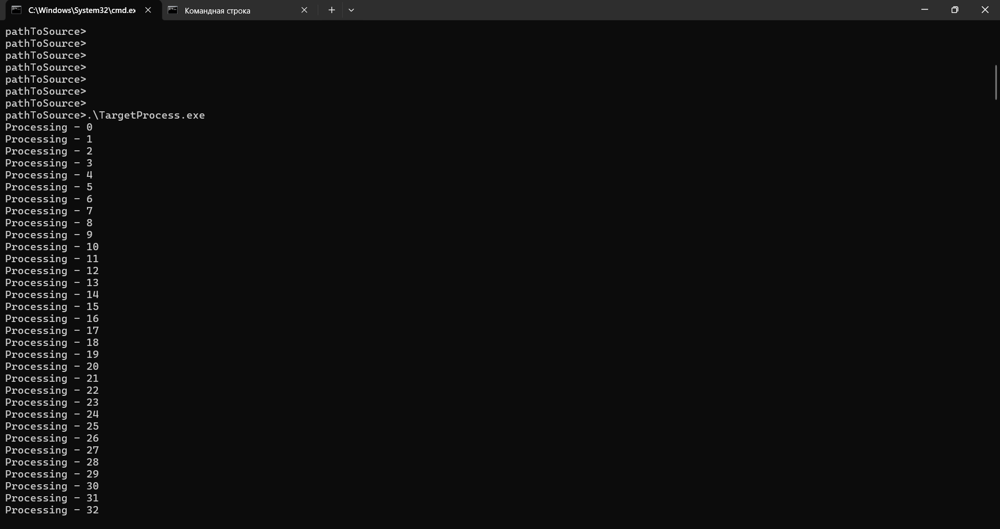

1. Если запустить процесс, который напрямую загружает к себе вирус, то получим:

```bash
.\DLLLoader.exe
```

Процесс сам загружает в себя вирус:
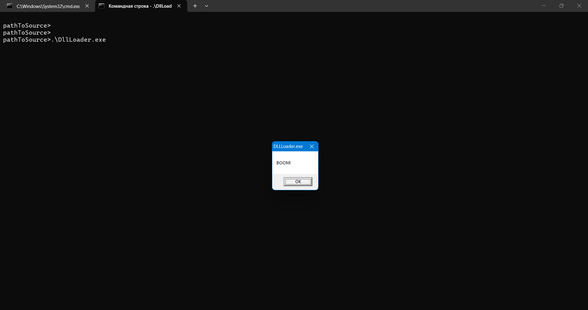

2. Инъекция через другой процесс-инъектор:

```bash
.\DllInjectorAsProcess.exe <processId>
```

Процесс и подключенные библиотеки:
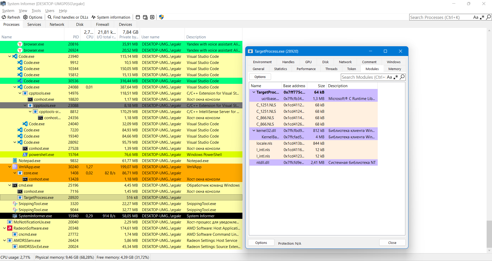

Запуск инъектора:
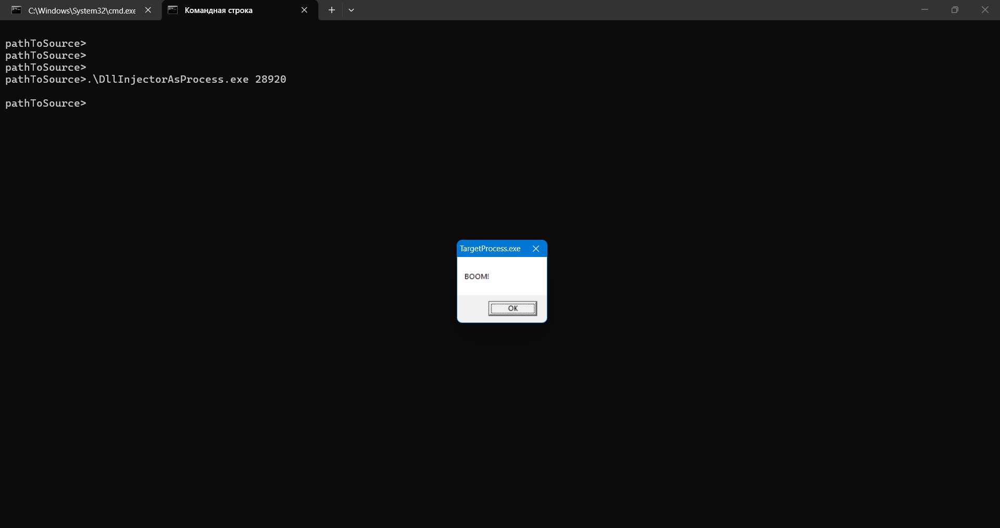

Вирус в подключенных библиотеках после инъекции:
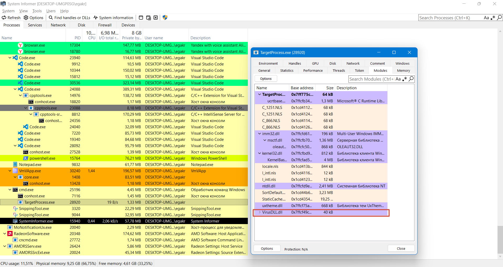

3. Инъекция через DLL-инъектор:

```bash
rundll32.exe .\DllInjectorAsDll.dll HelperFunc <processId>
```

Процесс и подключенные библиотеки:
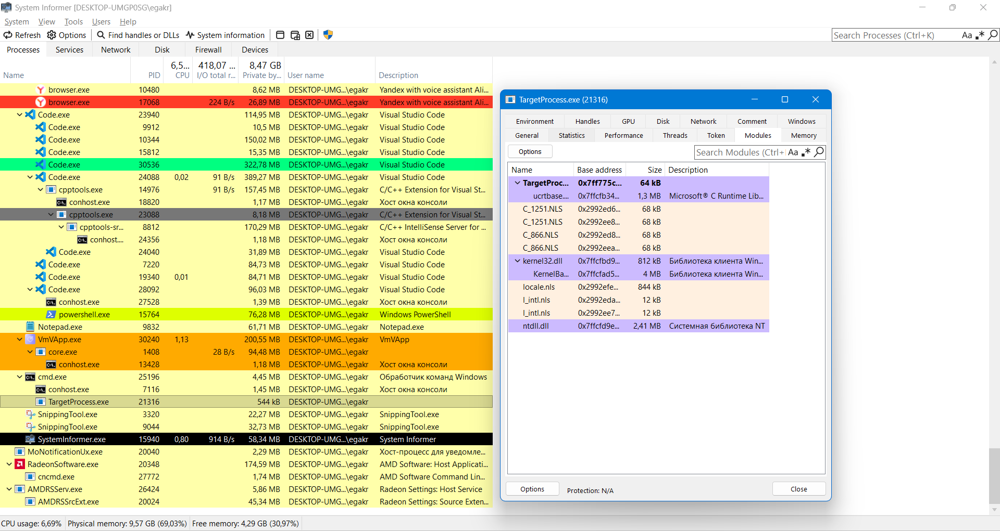

Запуск инъектора:
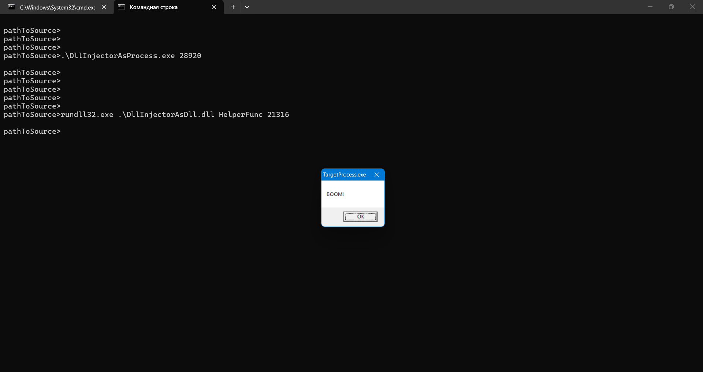

Вирус в подключенных библиотеках после инъекции:
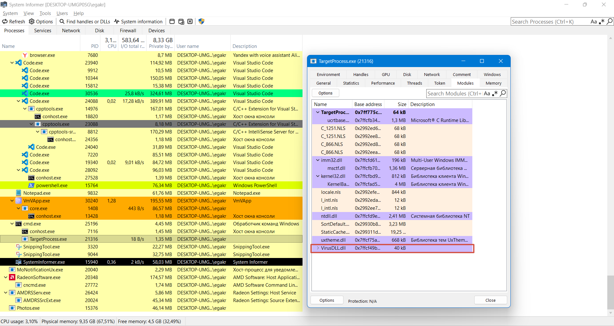

4. Подключение вредоносной библиотеки через Process Informer:

Options -> Load Module...:
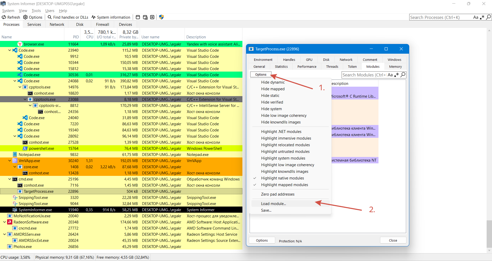

Выбираем VirusDLL.dll:
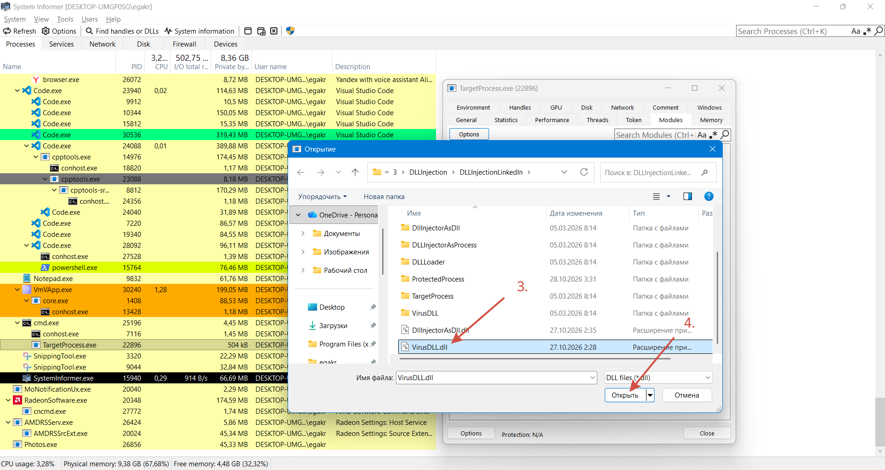

Инъекция прошла:
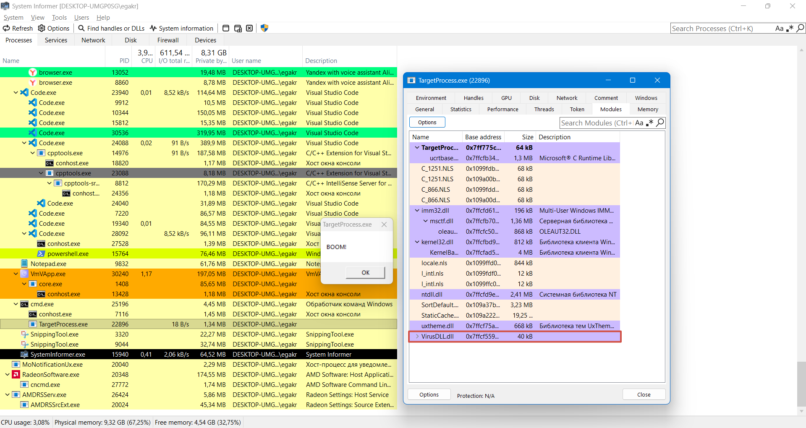

#### **Как реализуется защита от инъекции:**
Процесс выполняет следующие действия перед началом полезной работы:

1. Вызывает GetProcessMitigationPolicy() для проверки, включена ли в текущем процессе политика MicrosoftSignedOnly.

2. Если защита отсутствует, вызывает GetModuleFileNameW -> получает путь до собственного .exe.

3. Вызывает InitializeProcThreadAttributeList без указателя на участок памяти -> получает размер памяти, необходимый для списка атрибутов.

4. С помощью HeapAlloc выделяет память под список атрибутов.

5. Повторно вызывает InitializeProcThreadAttributeList с указателем на выделенный участок памяти, где будет инициализирован участок памяти.

6. Задаёт политику PROCESS_CREATION_MITIGATION_POLICY_BLOCK_NON_MICROSOFT_BINARIES_ALWAYS_ON, которая запрещает загрузку бинарных файлов, не подписанных Microsoft.

7. Вызывает UpdateProcThreadAttribute(), чтобы добавить политику защиты в список атрибутов пересоздаваемого процесса.

8. Передаёт список атрибутов в структуру STARTUPINFOEXW

9. Вызывает CreateProcessW с флагом EXTENDED_STARTUPINFO_PRESENT, создавая новый экземпляр собственной программы с заданной политикой защиты.

10. Получает PID нового процесса, хендлер процесса и хендлер потока через PROCESS_INFORMATION.

11. Вызывает DeleteProcThreadAttributeList и HeapFree для освобождения памяти, выделенной под список атрибутов.

12. Пересозданный процесс при запуске проверяет защиту через GetProcessMitigationPolicy и обнаруживает, что политика MicrosoftSignedOnly включена.


#### **Защита от инъекции:**

Компиляция кода с защитой:
```bash
g++ -o ProtectedProcess.exe ./ProtectedProcess/Source.cpp
```
Запускаем защищенный процесс:
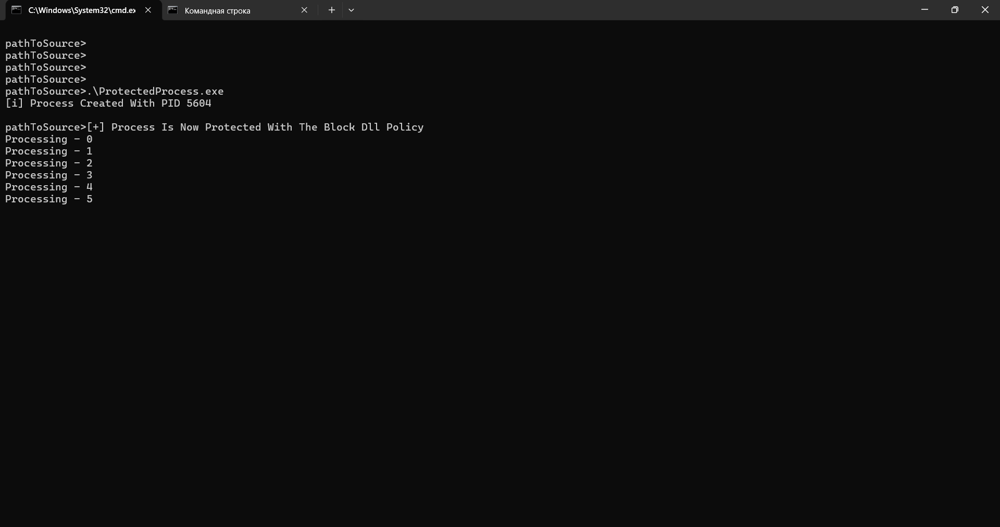

1. Попытка инъекции через DllInjectorAsProcess.exe:
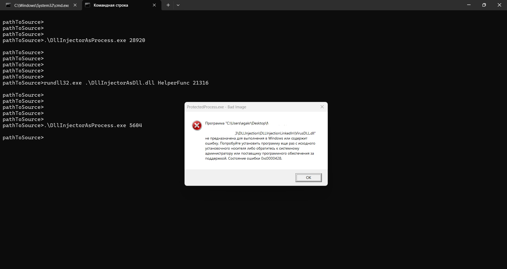

2. Попытка инъекции через badDllInjectorAsDll.exe:
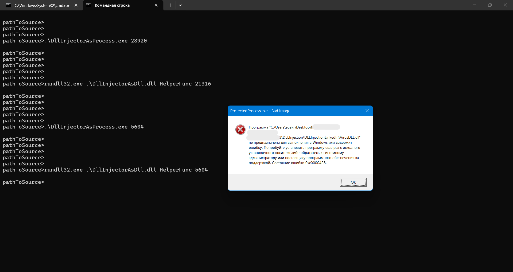

3. Попытка инъекции через Process Informer:
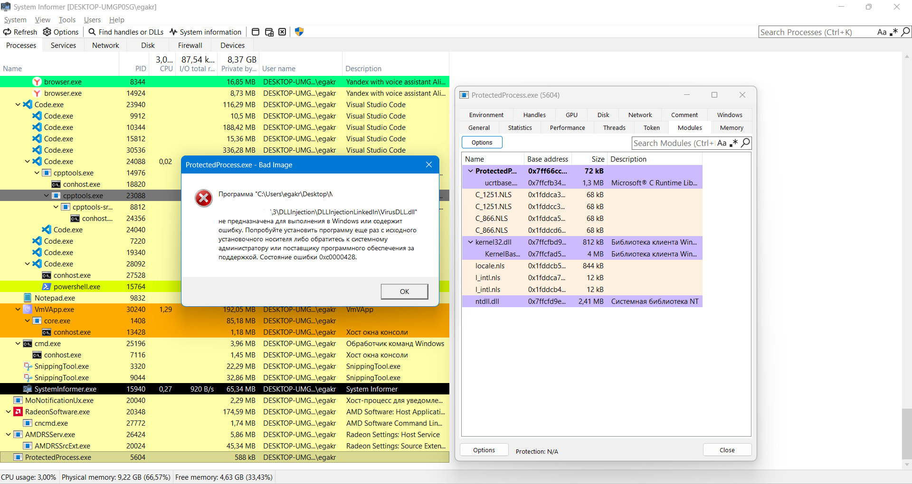

Подключенные библиотеки после 3 попыток инъекции: 
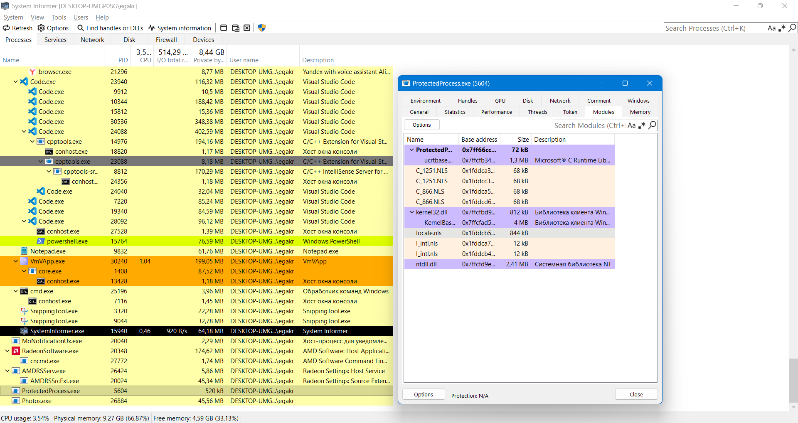